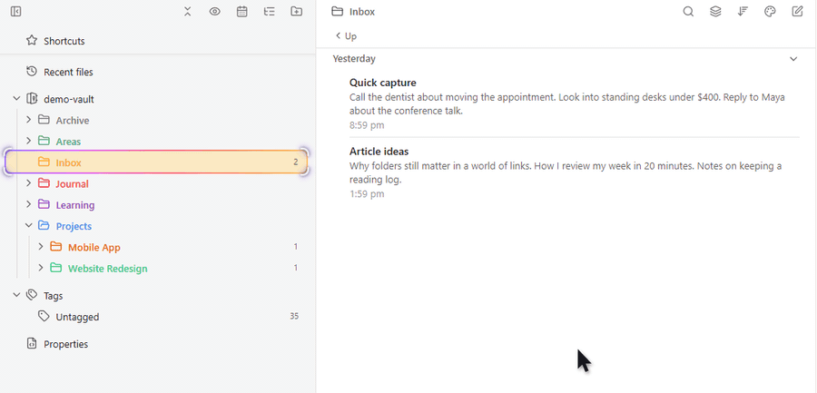
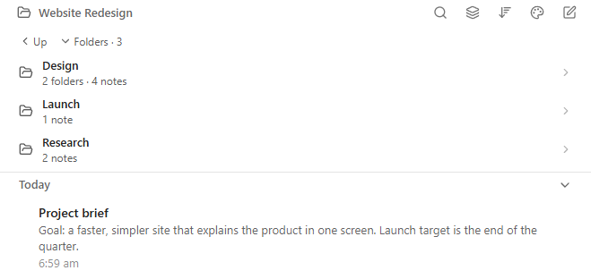
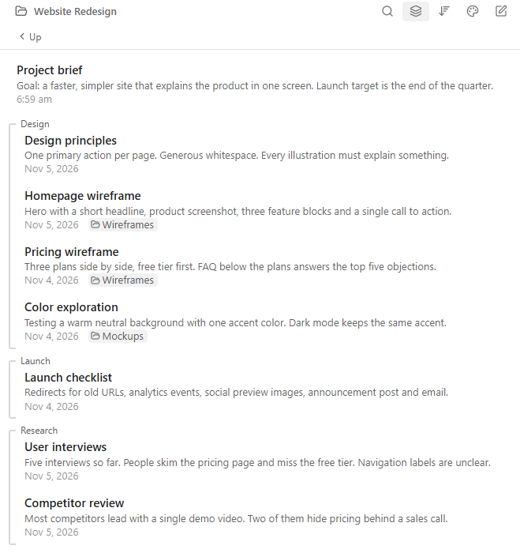
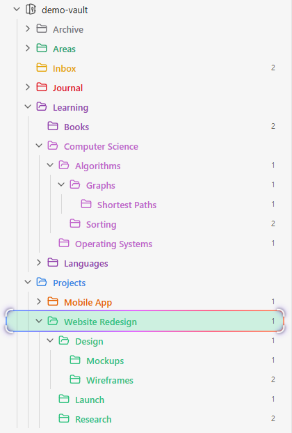
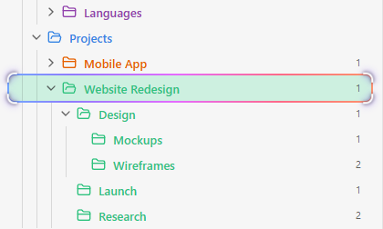

# Notebook Navigator Folder Tools

**English** | [简体中文](README.zh-CN.md)

Add subfolder drill-down to the Notebook Navigator list pane, plus folder tree indent guides, a locate effect for the selected folder, and grouping of subfolder notes.

A companion for [Notebook Navigator](https://github.com/johansan/notebook-navigator). Notebook Navigator itself is never modified; turn this off any time to get the stock look back.

> Not affiliated with Notebook Navigator or its author.



## Features

### Subfolders in the list pane

Click a subfolder to open it. The folder tree follows along, and **Up** goes back.

Notebook Navigator's list pane normally shows only notes, so going into a subfolder means going back to the folder tree. This plugin lists the current folder's subfolders at the top of the list pane, each with its counts of folders and notes. Clicking one opens it right there, while the folder tree on the left expands to it, selects it and scrolls it into view, so both panes always agree on where you are. **Up** takes you back one level and keeps its place even in a top-level folder, so the buttons never jump under your mouse. **Folders · N** collapses the list when you want more room for notes and remembers your choice. Hidden folders, folder order, colors and icons all follow your Notebook Navigator settings.



### Notes from subfolders, grouped

With "Show notes from subfolders" on, notes are grouped by subfolder. Deeper notes show their path.

Notebook Navigator's "Show notes from subfolders" puts every note from every subfolder into one long list, so it is hard to tell where a note lives. With this feature the folder's own notes come first, followed by one group per direct subfolder, marked by a quiet bracket with the folder name on top (click the name to open that folder). Notes from deeper folders stay in their group with a small path chip such as `Wireframes`, and groups only take a color if you colored that folder. Note rows follow Notebook Navigator's own preview, date format and sort order. **Hide previews in the grouped list** gives a denser list with only title, date and path, and affects only this grouped list. Large folders are drawn in batches as you scroll, and previews are read only for notes you see.



### Indent guides

Lines in the folder tree, styled like Obsidian's file explorer.

In a deep folder tree it is easy to lose track of which folder a row belongs to. Each expanded folder gets a solid vertical line from its first child to its last, exactly like the guides in Obsidian's built-in file explorer. The lines use your theme's guide color and width, so they match light and dark themes, and Notebook Navigator's own guides on folder rows are hidden while this is on so you never see two sets.



### Find the selected folder

A rainbow outline and closing-in corners, easy to spot among colored folders. Each can be turned off.

When folders have their own colors, the normal selection highlight blends in and it is hard to see which folder is open. The **rainbow marquee** draws a slowly flowing rainbow outline around the selected row, and the **corner lock** brings four corner marks in on the folder when you arrive, then lets them breathe gently. Each has its own switch; with both off the row looks exactly like stock Notebook Navigator. **Auto fade** hides the effects 5 seconds after you arrive, if you only want a quick "you are here", and both effects respect the system "reduce motion" setting.



## Installation

1. Install and enable **Notebook Navigator** first.
2. In Obsidian, open **Settings → Community plugins → Browse**, search for **Notebook Navigator Folder Tools**, install and enable it.

Manual install: download `main.js`, `manifest.json` and `styles.css` from the [latest release](https://github.com/letheli710/obsidian-notebook-navigator-folder-tools/releases/latest) into `<your vault>/.obsidian/plugins/notebook-navigator-folder-tools/`, then enable the plugin in Settings.

## Settings

| Setting | Default | What it does |
| --- | --- | --- |
| Indent guides | On | Lines under expanded folders in the folder tree. Hides Notebook Navigator's own guides on folder rows while on. |
| Rainbow marquee | On | Flowing outline around the selected folder. |
| Corner lock | On | Corner marks that close in on arrival, then breathe gently. |
| Auto fade | Off | Fades the two effects 5 seconds after arriving at a folder. |
| Show subfolders | On | Subfolders above the notes in the list pane. |
| Up one level button | On | Button above the subfolders that goes to the parent folder. |
| Group notes from subfolders | On | Groups notes by subfolder while "Show notes from subfolders" is on. |
| Hide previews in the grouped list | Off | Only title, date and path in the grouped list. Notebook Navigator's own list is not affected. |

## FAQ

### How do I show subfolders in the Notebook Navigator list pane?

Install this plugin. The list pane then lists the current folder's subfolders above the notes, and clicking one enters it.

### How do I add indent guides to Notebook Navigator like Obsidian's file explorer?

Turn on "Indent guides" (on by default). Each expanded folder gets a line in the same style as the built-in file explorer.

### How can I see which subfolder a note comes from when "Show notes from subfolders" is on?

Keep "Group notes from subfolders" on. Notes are grouped by direct subfolder, and deeper notes show their folder path.

### Can I navigate down into folders from the list pane (drill-down navigation)?

Yes. Click a subfolder in the list pane to go into it; use "Up" to go back. The navigation pane follows along.

### The selected folder is hard to spot among colored folders. Can it stand out more?

Yes: the rainbow marquee and corner lock make the selected folder obvious. Turn either off in settings.

### Does it slow down Obsidian?

No. It starts after the workspace is ready and only touches rows on screen. The settings tab shows its measured load time.

### Does it change Notebook Navigator or my notes?

No. It only adds to what you see, and never changes Notebook Navigator's files, its settings or your notes.

## Compatibility and limitations

- Needs Notebook Navigator and Obsidian 1.8.7+. Tested on desktop with Notebook Navigator 3.5; less tested on mobile.
- A big Notebook Navigator update may break a feature until this plugin catches up. Please [open an issue](https://github.com/letheli710/obsidian-notebook-navigator-folder-tools/issues) if that happens.
- The grouped list shows Markdown notes only, without keyboard navigation, multi-select or drag and drop.
- Indent guides assume a left-to-right layout.

## Development

```bash
npm install
npm run dev     # rebuild main.js on change
npm run build   # type check and production build
npm run lint    # the same lint rules as the Obsidian plugin review
npm test        # unit tests
```

All Notebook Navigator interface names this plugin relies on are in `src/selectors.ts`.

## License

[MIT](LICENSE)
