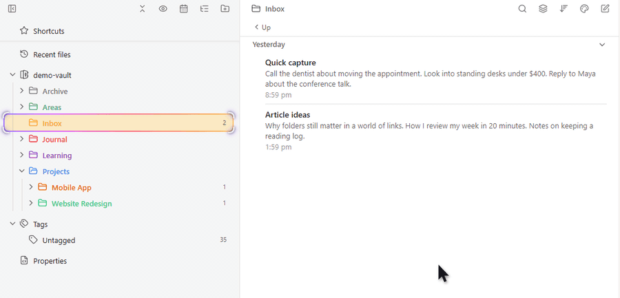
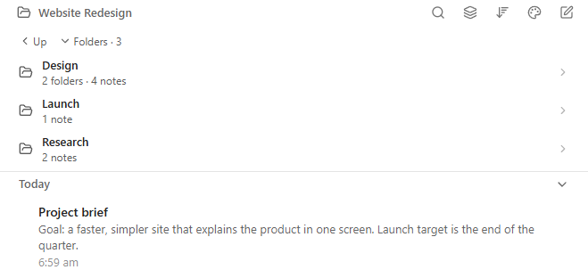
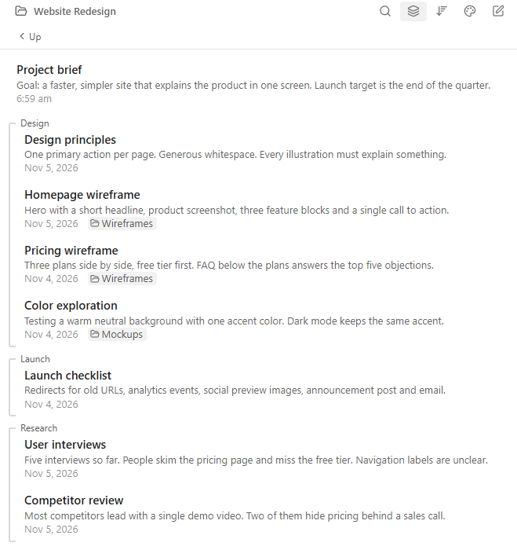
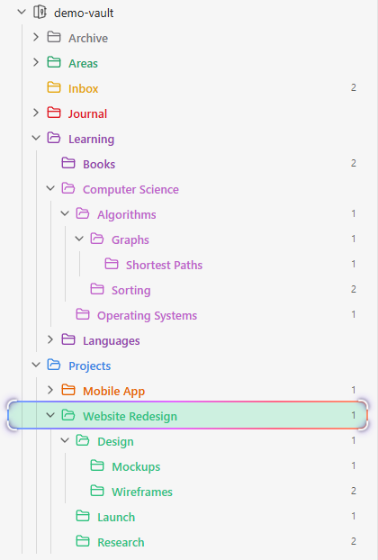
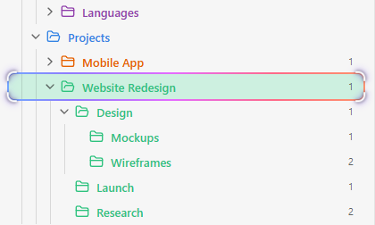

# Notebook Navigator Folder Tools

[English](README.md) | **简体中文**

让 Notebook Navigator 的右栏显示子文件夹并可以逐层进入，同时为左栏文件夹树加上层级线、为选中的文件夹加上定位效果，并把子文件夹的笔记按文件夹分组。

这是 [Notebook Navigator](https://github.com/johansan/notebook-navigator) 的配套插件，不会修改 Notebook Navigator 本身。随时关掉即恢复原样。

> 本插件与 Notebook Navigator 及其作者无关，非官方出品。



## 功能

### 右栏显示子文件夹

点击子文件夹进入下一层，左栏同步展开；「上一层」返回。

Notebook Navigator 的右栏原本只列笔记，想进子文件夹得回到左栏去点。本插件在右栏顶部列出当前文件夹的子文件夹，并显示各自包含多少文件夹和笔记。点击就在右栏进入，同时左栏自动展开到这个文件夹、选中并滚动到可见位置，两栏始终一致。「上一层」按钮返回上一级，在顶层文件夹也保留位置，按钮不会在鼠标底下跳来跳去。「文件夹 · N」可以收起子文件夹列表给笔记腾地方，并记住你的选择。隐藏文件夹、排序、颜色和图标都沿用 Notebook Navigator 的设置。



### 子文件夹笔记分组

开启「显示子文件夹的笔记」时按子文件夹分组，深层笔记标出路径。

Notebook Navigator 的「显示子文件夹的笔记」会把所有子文件夹的笔记混成一长串，看不出每篇笔记在哪。开启分组后，当前文件夹自己的笔记在最前，后面每个直接子文件夹一组，左侧一个淡淡的方括号，文件夹名写在上方，点名字可以进入该文件夹。更深层的笔记留在所属的组里，标题下方带路径小标签（例如 `Wireframes`）；只有你给文件夹设了颜色，分组才带颜色。笔记行沿用 Notebook Navigator 的预览、日期格式和排序。「分组列表隐藏预览」让列表更紧凑，只显示标题、日期和路径，并且只影响这个分组列表。大文件夹会边滚动边分批绘制，预览也只读取看得见的笔记。



### 层级线

左栏文件夹树的竖线，和 Obsidian 自带文件列表一样。

文件夹层级一深，就容易看不清某一行属于哪个文件夹。每个展开的文件夹会从第一个子项到最后一个子项画一条实线，和 Obsidian 自带文件列表的样式一致。线的颜色和粗细跟随主题，浅色和深色主题下都协调；开启时会隐藏 Notebook Navigator 自己在文件夹行上的缩进线，避免出现两套线。



### 一眼找到选中的文件夹

彩虹边框和四角收拢，在彩色文件夹里也一眼看到当前位置，两个效果都能单独关闭。

给文件夹设了颜色以后，普通的选中高亮会和这些颜色混在一起，很难看出现在打开的是哪个文件夹。「彩色跑马灯」在选中行外圈画一圈缓缓流动的彩虹边框；「四角锁定」在你到达时让四个角向文件夹收拢，之后轻轻呼吸。两个效果各有开关，都关掉就和原版 Notebook Navigator 完全一样。「自动淡出」让效果在到达 5 秒后消失，适合只想要一个短暂的「你在这里」提示；系统开启「减少动态效果」时动画会自动减弱。



## 安装

1. 先安装并启用 **Notebook Navigator**。
2. 在 Obsidian 中打开 **设置 → 第三方插件 → 浏览**，搜索 **Notebook Navigator Folder Tools**，安装并启用。

手动安装：从 [最新版本](https://github.com/letheli710/obsidian-notebook-navigator-folder-tools/releases/latest) 下载 `main.js`、`manifest.json` 和 `styles.css`，放到 `<你的仓库>/.obsidian/plugins/notebook-navigator-folder-tools/`，然后在设置里启用插件。

## 设置

Obsidian 为中文界面时，设置页也显示中文。

| 设置 | 默认 | 作用 |
| --- | --- | --- |
| 层级线 | 开 | 左栏展开的文件夹下画竖线。开启时隐藏 Notebook Navigator 自带的文件夹缩进线。 |
| 彩色跑马灯 | 开 | 选中文件夹外圈流动的彩虹边框。 |
| 四角锁定 | 开 | 到达时四角收拢，之后轻轻呼吸。 |
| 自动淡出 | 关 | 到达文件夹 5 秒后淡出上面两个效果。 |
| 显示子文件夹 | 开 | 在右栏笔记上方显示子文件夹。 |
| 返回上一层按钮 | 开 | 子文件夹上方的「上一层」按钮，回到父文件夹。 |
| 子文件夹笔记按文件夹分组 | 开 | 开启「显示子文件夹的笔记」时，按子文件夹分组。 |
| 分组列表隐藏预览 | 关 | 分组列表只显示标题、日期和路径，Notebook Navigator 自己的列表不受影响。 |

## 常见问题

### 怎样在 Notebook Navigator 的右栏显示子文件夹？

安装本插件即可。右栏会在笔记上方列出当前文件夹的子文件夹，点击就能进入。

### 怎样给 Notebook Navigator 加上和 Obsidian 文件列表一样的层级线？

打开「层级线」（默认开启）。每个展开的文件夹都会有一条和自带文件列表样式相同的竖线。

### 开启「显示子文件夹的笔记」后，怎样看出每篇笔记来自哪个子文件夹？

保持「子文件夹笔记按文件夹分组」开启。笔记会按直接子文件夹分组，更深层的笔记会标出所在路径。

### 能在右栏逐层进入文件夹吗？

可以。在右栏点击子文件夹进入，用「上一层」返回，左栏会同步跟随。

### 彩色文件夹里很难看出选中了哪个，能更醒目吗？

可以。彩色跑马灯和四角锁定会让选中的文件夹非常明显，两者都能在设置里关闭。

### 会拖慢 Obsidian 吗？

不会。它在工作区准备好之后才开始工作，只处理屏幕上看得见的行。设置页里可以看到它实测的加载耗时。

### 会改动 Notebook Navigator 或我的笔记吗？

不会。它只在界面上增加内容，从不改动 Notebook Navigator 的文件、设置或你的笔记。

## 兼容性与限制

- 需要 Notebook Navigator 和 Obsidian 1.8.7 或更高版本。已在桌面端配合 Notebook Navigator 3.5 测试；移动端测试较少。
- Notebook Navigator 的大版本更新可能让某个功能暂时失效，直到本插件跟进。遇到这种情况请 [提交 issue](https://github.com/letheli710/obsidian-notebook-navigator-folder-tools/issues)。
- 分组列表只显示 Markdown 笔记，不支持键盘上下选择、多选和拖拽。
- 层级线按从左到右的排版设计。

## 开发

```bash
npm install
npm run dev     # 文件变动时自动重新构建 main.js
npm run build   # 类型检查并生成正式构建
npm run lint    # 与 Obsidian 插件审核相同的检查规则
npm test        # 单元测试
```

插件依赖的所有 Notebook Navigator 界面名称都集中在 `src/selectors.ts`。

## 许可证

[MIT](LICENSE)
